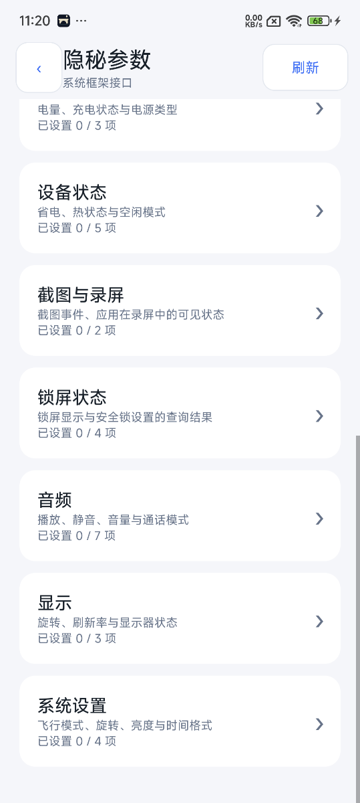
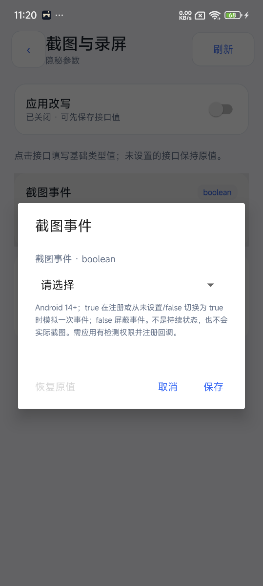
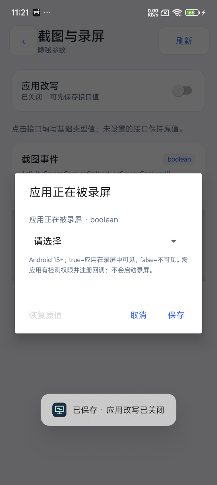

# 扩展系统框架接口 · Display 0.4.0

目录从 21 组规则 / 29 个基础字段扩展到 **51 组规则 / 63 个基础字段、12 个类别**。原有配置格式、控制 AIDL 事务号和 ProjectCore 原子存储协议不变；两份 DisplayContract 同步升级，PosEdMCP 1.1.6 使用同一校验目录。单配置上限仍为 64 条；固定时间和偏移互斥，所以不能同时启用整个目录。

## 本次新增

| 类别 | 规则键（省略公共前缀） | 基础输入 |
| --- | --- | --- |
| capture | screenshotEvent、recordingVisible | boolean |
| security | keyguardLocked、deviceLocked、keyguardSecure、deviceSecure | boolean |
| audio | ringerMode、mode、musicActive、microphoneMute、speakerphoneOn、musicVolumePercent、alarmVolumePercent | int / boolean |
| display | rotation、refreshRate、state | int / float |
| state | thermalStatus、lightDeviceIdle | int / boolean |
| settings | airplaneMode、autoRotate、time24Hour、brightness | boolean / int |
| network | wifiEnabled、wifiRssi、wifiLinkSpeed | boolean / int |
| sensors | linearAcceleration、gravity、ambientTemperature、relativeHumidity、stepCounter | 独立 float 输入；三轴分别 X/Y/Z |

页面顺序为作用域应用、类别、接口字段、基础值表单。接口条目显示原生 API、类型和取值提示，不要求用户输入 JSONObject、数组文本或其他高级对象。新增范围检查与两端契约一致。音量百分比映射到原音频流的 min/max 索引，保留实际硬件范围；不会改变系统音量。

## 截图与录屏的准确含义

Android 14 的截图检测是 Activity 级的**事件通知**，没有“正在截图”的持续状态；它不提供图片，也不覆盖所有截图途径。官方文档指出 Android 14 不对 ADB 或测试截屏发出此事件。[Android 截图检测说明](https://developer.android.com/about/versions/14/features/screenshot-detection)。

`capture.screenshotEvent`（Android 14+）作用于应用已注册的 `Activity.ScreenCaptureCallback`：

- 不设置：透传真实事件。
- false：屏蔽后续真实截图回调，不生成模拟事件。
- true：成功注册回调时模拟一次；已有注册从未设置/false 切换到 true 时模拟一次。其他配置修订不会重复触发。true 下真实截图事件仍可透传。
- 清除：恢复真实事件透传，不伪造“截图结束”事件。

Android 15 的录屏检测表示**该应用的 Activity 是否在录屏中可见**，不是全设备任意软件是否在录屏。原 API 返回当前状态，并通过 Consumer<Integer> 通知变化；0=不可见，1=可见。[WindowManager 官方接口](https://developer.android.com/reference/android/view/WindowManager#addScreenRecordingCallback(java.util.concurrent.Executor,java.util.function.Consumer%3Cjava.lang.Integer%3E))。

`capture.recordingVisible`（Android 15+）用 boolean 编辑：true 映射 1，false 映射 0。覆盖初次注册返回值、真实状态变化回调，以及已注册时修改配置产生的状态通知；清除配置后通知最近观察到的真实状态。底层真实状态缓存不会被改成伪造值。

两者保留原 API 的权限和注册异常：分别要求目标声明 `DETECT_SCREEN_CAPTURE`、`DETECT_SCREEN_RECORDING`。不会替目标授予权限、替目标注册监听、实际截图、启动录屏、获取截图内容或改动 FLAG_SECURE。通知通过目标注册时提供的 Executor 派发；注销后取消待发的合成通知。弱引用只用于附加索引，系统保存的包装回调仍强持有应用原回调，保持正常注册寿命。实现根据 [AOSP ScreenRecordingCallbacks](https://android.googlesource.com/platform/frameworks/base/+/refs/heads/android15-release/core/java/android/view/ScreenRecordingCallbacks.java) 与 [ScreenCaptureCallbackHandler](https://android.googlesource.com/platform/frameworks/base/+/refs/heads/android15-release/core/java/android/app/ScreenCaptureCallbackHandler.java) 的注册/移除边界。

## 覆盖边界

锁屏、麦克风静音、飞行模式、亮度等条目改写**进程内查询结果**，不执行对应系统设置、不解锁设备、不切换无线电或麦克风。显示参数不调整真实屏幕，也不重写整个 WindowMetrics、Configuration、DisplayMetrics 或渲染分辨率。旋转值使用 Surface 的 0–3 常量，不是角度；刷新率同时覆盖 Display 与 Display.Mode 的 getRefreshRate。热状态只覆盖当前状态查询，未改写热状态监听器。Wi-Fi 条目不更换 IP、路由、SSID 或连接回调。

设置条目覆盖 Settings.System/Global 的 getStringForUser 读取入口，其 getString/getInt/getLong/getFloat 系列解析该结果；24 小时制还覆盖 DateFormat.is24HourFormat。不会改写 ContentObserver 事件或数据库。跨用户原权限检查仍先执行。

新增传感器沿用真实事件派发入口，仅克隆并替换 float[]，保留频率、时间戳与原订阅权限。设备缺少环境温度/湿度传感器时不会生成传感器；计步器仍要求 ACTIVITY_RECOGNITION。[Android Sensor 官方定义](https://developer.android.com/reference/android/hardware/Sensor#TYPE_STEP_COUNTER)。步数以系统事件原有 float 存储，高位数值受 float 精度限制，不会重置真实累计值。

应用直接访问 Binder、JNI、厂商接口、已缓存值或被 ART 内联的调用方时可能绕过这些 Java 入口；已有 Chromium 定位兼容处理不代表所有新增接口的内联调用都已覆盖。capabilities 的 backendImplemented 是实现目录，minimumSdk 是接口要求，具体进程以 runtime_state 的支持集合和实际取值为准。

## 验证

主机回归 518 项：Frontend 205、Core 26、Project 191、Advanced 96。新增检查覆盖严格类型与范围、63 个字段的表单映射、Executor 派发、身份映射、变化去重、真实状态恢复、注销取消和执行器拒绝。Display assembleDebug / lintDebug 通过，0 错误、3 项原有警告；PosEdMCP assembleDebug 通过。

真机结果另见同目录 `expanded-*.json`。隔离框架回调夹具会创建独立的 AOSP handler/registry，并使用哨兵防止 Binder 注册/注销；它不替代具备检测权限的真实应用完整录屏会话测试。权限检查使用另一个独立实例真实调用系统服务，确认缺少权限仍抛出 SecurityException。

小米15 / Android15 / Vector2.2 实测：

- [隐秘参数扩展测试](expanded-smoke.json)：27项新增查询匹配，清除后31项读取与进程内基线一致；新增线性加速度、重力事件值及单调时间戳通过。环境温度/湿度硬件不存在，计步权限未授予，均如实标记，没有生成不存在的事件。31项恢复包含4项未改写的音量范围读取。
- 同一记录中的隔离回调夹具验证录屏初次返回1、真实状态变化时覆盖为1、配置切换为false时回调0、清除时恢复最近真实0；截图true模拟一次、false屏蔽派发、注销后计数不再变化。Android系统服务的录屏检测权限异常仍保留。
- [Edge真实截图回调](expanded-edge-screenshot.json)：目标具备DETECT_SCREEN_CAPTURE，以真实Activity注册；配置启用模拟一次，重复注册仍被系统拒绝，注销后再切换配置不增加计数。所有关键读取PID一致。没有实际截取图片、读取网页、发起录屏或测试真实硬件按键截图。
- Edge复测曾因MCP任意进程路由读到Chromium子进程尚未登记的探针零计数而误判，原记录保留为[未固定读取进程的记录](expanded-edge-unpinned-read.json)。探针现仅在曾成功登记的进程返回计数，并校验与登记PID一致；未把该次零结果删除或冒充成功。
- [UI检查](expanded-ui-checks.json)：截图事件false可在关闭状态保存、重新打开保留false，目标仍未绑定；恢复原值后草稿为空。录屏说明显示系统版本、权限和应用可见性语义。两个布尔表单均为基础选择器。
- 本轮最终目标：隐秘参数revision17、Edge revision18，profileId均为空；活跃进程已确认相应清除版本，无Hook失败。AIDL测试profile仍保存为未绑定测试样例，不会自动启用。

当前完整的、获授权的真实录屏会话尚未验收；录屏路径证据是设备上的隔离框架回调夹具与系统权限异常测试，不能据此声称所有录屏软件或厂商路径已覆盖。

| 新类别 | 截图事件基础编辑 | 录屏状态基础编辑 |
| --- | --- | --- |
|  |  |  |

Edge 旧版整组 20 规则冷启动的 native 崩溃尚未定位，本次不会给 Edge 批量启用新增规则。
