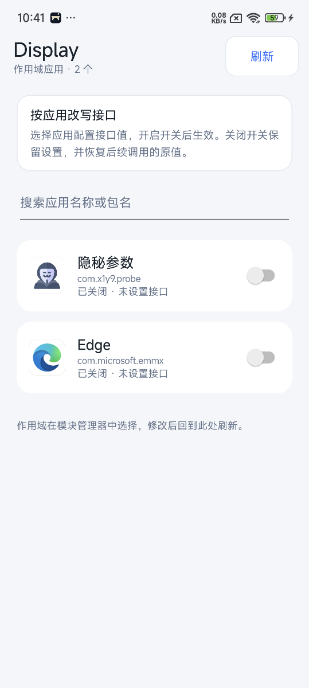
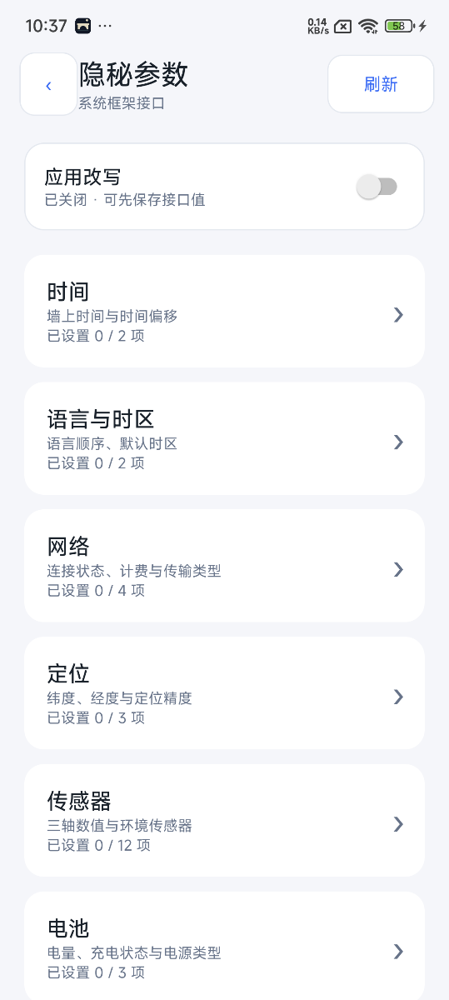
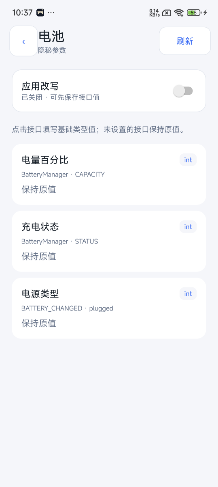
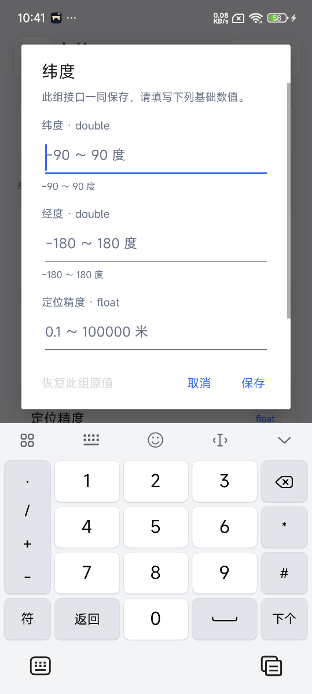

# Project UI 0.4.0

Display 现有桌面入口，界面为「作用域应用 → 系统框架接口类别 → 接口列表 → 基础值编辑」。支持系统浅色/深色主题、返回手势、应用搜索和刷新。分类覆盖时间、语言与时区、网络、定位、传感器、电池、设备状态、截图与录屏、锁屏、音频、显示、系统设置，共51组后端规则、63个可点击基础字段入口。扩展语义与本轮验证见 [EXPANDED-HOOKS.md](EXPANDED-HOOKS.md)。

## 操作语义

首页只读取框架真实作用域。作用域增删仍在模块管理器中完成，回到 Display 刷新即可。应用开关控制参数改写；关闭时保留设置、撤回目标绑定，重新开启时应用保存的设置。空配置不能开启，会引导进入类别页面。未安装的旧作用域条目显示包名且禁用开关。

未设置的接口显示「保持原值」。关闭应用时也可编辑并保存，保存不会自动开启。开启应用时保存会发布新配置；目标进程按原运行通道同步，通常约1秒，冻结或应用缓存可能需要重新打开或刷新。开关表示配置启用意图，不代表所有进程或所有读取路径已验证生效。

数字使用 int/long/float/double 输入框，布尔值选择 true/false，字符串直接输入文本，枚举选项显示其基础整数或字符串值。没有 JSON、对象构造器或高级对象文本输入。

定位在三级页面分别列出 getLatitude、getLongitude、getAccuracy，三轴传感器分别列出 X/Y/Z 字段。点击任一字段时以多个基础输入框编辑该组；首次保存必须补齐全部字段，内部才封装为对象或数组，不擅自填入其他坐标或传感器轴值。恢复原值也以该组为单位。语言顺序是1–8个独立语言标签文本框，允许添加，空白项忽略。固定时间与时间偏移互斥，保存其中之一会替换另一项，编辑器会提示。

错误输入保留在编辑器中并显示校验错误。取消不保存。旋转重建时保留页面、搜索、滚动位置及未保存输入；若版本已变化则提示重新编辑。保存失败或并发冲突不会覆盖其他入口的配置，界面刷新后可重新编辑。

## Core 端口与存储

新建进程内 `ProjectCore` 端口，`ProfileCore` 同时实现 AIDL 使用的 DisplayCore 与 UI 使用的 ProjectCore。没有新增导出 Binder、权限或 AIDL 事务。UI的Core读写、框架查询和应用元数据/图标加载都在工作线程，界面不直接改存储文件。

每个应用使用 `project.<包名SHA256前16字节>` 保存配置，沿用 profiles 表、版本、墓碑和原子文件，旧状态格式不变。`getProject` 在应用启用时读取目标固定快照，包括来自 PosEdMCP 的配置；关闭时读取 UI 保存的配置。UI 不把同名 profile 的最新内容冒充目标正在使用的固定版本。

`saveProject` 一次校验配置版本与目标版本，单次 AtomicFile 提交同时更新保存值和应用绑定；任一版本冲突、作用域校验或磁盘写入失败都不发布半成品。空配置以墓碑保存版本，不能启用；清空仍被其他目标引用的配置会拒绝。成功变更沿用最近256条 requestId 去重。原有128条 profiles/targets 含墓碑限制仍适用。

应用关闭会保留原配置；若当前配置来自 AIDL，则复制其实际固定值到该应用的 UI 配置后撤回目标，原 AIDL profile 不被修改。这样 UI 开关和 AIDL 能在同一 Core 状态下协作。

UI Activity 不接受外部 Intent 参数执行保存或启用。UI 用户点击直接调用进程内 Core；通过 PosEdMCP 自动测试屏幕、输入和 Lua 时仍保留其原有确认策略。

## 0.3.0 初版 UI 验证（历史）

主机：原175项前端+26项Core回归通过，新增101项Project回归通过，共302项。新增检查涵盖21条规则的基础编辑映射、组合字段完整性、范围/非有限数值、false保留、时间互斥、原子开启/关闭、保存失败、版本冲突、AIDL固定版本、其他目标引用保护、重启持久化、并发CAS唯一赢家。

构建：JDK22、SDK36、AGP8.13.2，assembleDebug和lintDebug通过。Lint仍保留原3项警告；返回手势在API33+注册原生 OnBackInvokedDispatcher，API31/32才使用旧回调。数字键盘遮挡实机发现后已通过对话框 adjustResize 修复并复核。

小米15 / Android15 / Vector2.2 实机：

- 首页实际显示隐秘参数与Edge，空配置开启引导到类别页。
- 电量101被拒绝；37可保存为关闭状态，目标绑定保持空。
- UI开启后AIDL读到单条电量37配置；目标进程ACK后BatteryManager返回37，见project-ui-device-applied.json。首次快照尚未同步时曾读到不匹配，等待ACK后匹配，未将保存成功当作生效证明。
- UI关闭后目标解绑但37仍保留在编辑器，见project-ui-toggle-roundtrip.json；恢复原值后测试配置清空。
- 最终隐秘参数绑定rev6、Edge绑定rev4均为空；隐秘参数ACK6且电量恢复，见project-ui-runtime-restored.json与project-ui-device-restored.json。Edge配置未参与本轮修改。
- 已检查浅色首页、类别、接口列表、整数编辑器及定位数字键盘表单截图；键盘显示时可直接点击取消。深色主题与旋转恢复已有实现，本轮未在设备上做专项验收。

实机截图：

| 首页 | 类别 | 接口列表 |
| --- | --- | --- |
|  |  |  |

以下记录属于 0.3.0 初版 UI 验收；0.4.0 已扩展钩子，见扩展接口文档。旧版Edge混合20规则冷启动崩溃的未解决限制仍见[BACKEND.md](BACKEND.md)，UI不会自动添加整套示例值。
