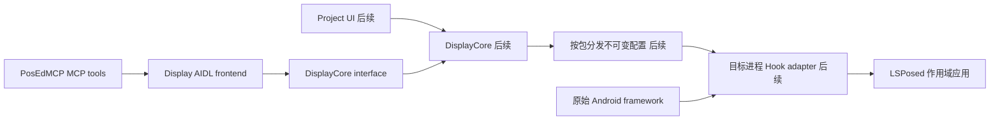

> 新增接口研究与0.4.0验证见 [EXPANDED-HOOKS.md](EXPANDED-HOOKS.md)，含Android14截图事件和Android15录屏状态的原生接口与AOSP来源。

# Display 研究与架构决策

> 此文保留0.1.0研究阶段的决策过程。“后续Core/Hook”现已在0.2.1实现，实际覆盖与限制以[BACKEND.md](BACKEND.md)为准。

研究日期：2026-10-22（Asia/Shanghai）。资料以 Android 官方文档、libxposed 官方仓库，以及本机 Android SDK 36.1 源码为依据。以下区分平台事实、本项目设计和待设备验证项。研究阶段未连接设备，交付阶段已在小米 15（Android 15 / API 35）安装三个 APK 并核对版本与权限；没有把源码推断或安装成功写成 Hook 支持结论。

## 1. 对原始分层的具体化

`system -> DisplayCore -> AIDL / Project UI` 可以保留为逻辑分层，但实际运行必须区分控制面和目标应用内的数据面。

DisplayCore 负责规则解释、存储、冲突检查、分发及运行时状态。AIDL 和 UI 负责输入与展示，不能各持一份业务配置。目标应用读时间、接收传感器时，不应每次跨进程问 Display；后续适配器需要持有不可变配置快照，通过原子替换切换 revision。这是本项目基于跨进程开销和线程模型作出的设计。

实际 Hook 要发生在作用域应用进程的框架调用入口或事件分发入口。不能把“system”理解为首版就统一 Hook system_server：那会使应用隔离、Binder 调用者归属和系统稳定性复杂化。本轮禁止 android/system_server、Display、PosEdMCP、Deploy 作为目标，未实现更改全局系统设置的路径。

## 2. LSPosed 与框架选择

现代 API 使用 `META-INF/xposed/java_init.list`、`module.prop`、`scope.list`；模块应用与被 Hook 进程的通信需独立设计。官方指南说明 Remote Preferences / Remote Files 的共享机制。它们可以承担后续配置分发，但不是 PosEdMCP 对 Display 的外部 AIDL 契约。[LSPosed 现代 API 指南](https://github.com/LSPosed/LSPosed/wiki/Develop-Xposed-Modules-Using-Modern-Xposed-API)

libxposed 官方仓库当前示例依赖为 API 102.0.0，且 API 以 `compileOnly` 引入；模块与框架共享的类不能打包成另一份运行时 API。[libxposed API](https://github.com/libxposed/api)

现有 PosEdMCP 同时有 classic API 82 和 libxposed 102 入口，且记录了 Vector 兼容差异。本轮 Display 前端不依赖任一 Hook API。后续优先按现代 102 单独实现适配器，是否加入 classic 入口由目标设备验证决定；不承诺仅添加 metadata 就兼容全部 LSPosed 分支。

libxposed Service 是模块应用与框架的通信接口，并强调 Direct Boot 初始化与远程存储的可用性取决于框架。后续 Core 必须选择“解锁后加载”或设备保护存储，不能在开机锁定状态误读空配置为用户清除。[libxposed Service](https://github.com/libxposed/service)

**LSPosed 的真实作用域是最终边界。** AIDL 中提交包名不能授予 Hook 权限。后续 apply 必须检查框架实际 scope，并在运行状态中区分“请求的目标”“框架已允许”“该进程已加载”“revision 已确认”。目前这些都未知，而非假定 active。

## 3. 系统接口覆盖矩阵

以下是后续 Core 研发清单；“首版契约”表示本轮可校验该规则，不表示 Hook 已实现。

| 领域 | 首版契约键/后续扩展 | 候选框架入口 | 一致性与实现边界 |
| --- | --- | --- | --- |
| 墙上时间 | wallOffsetMillis、wallFixedMillis | System.currentTimeMillis、java.time / Calendar 的取时入口 | intrinsic/JIT/native 路径必须单独验证；固定时间会影响业务超时判断 |
| 单调时间 | 后续，首版不允许配置 | SystemClock.elapsedRealtime[Nanos]、uptimeMillis、nanoTime | 不随墙上时间偏移；计时器、睡眠和传感器时间戳不能各自漂移 |
| 语言与时区 | languageTags、timeZone | Locale、LocaleList、TimeZone、Configuration、Resources；API 33+ LocaleManager | 修改默认 Locale 不会自动重载所有 Resources；已有实例缓存可能要求重启 |
| 网络状态 | connected、validated、metered、transport | ConnectivityManager、NetworkCapabilities、NetworkCallback | getter 与 callback 同源；组合须由 Core 做语义检查；网络状态展示不改变真实路由 |
| 网络细节 | 后续 | LinkProperties、WifiInfo、TelephonyManager | SSID/BSSID/IP/DNS/运营商权限与脱敏不同，不能仅伪装 transport 就承诺覆盖 |
| 传感器 | accelerometer、gyroscope、magneticField、light、pressure、proximity | SensorManager 枚举/注册/注销、SystemSensorManager 事件分发 | 首版契约只定义固定样本值；频率、触发式传感器、轨迹重放另开版本 |
| 电池状态 | batteryLevel、batteryStatus、batteryPlugged | BatteryManager 属性/isCharging、ACTION_BATTERY_CHANGED | level/scale/status/plugged/充电属性需对应；sticky intent 与后续广播都要处理 |
| 电源状态 | powerSave、interactive、deviceIdle | PowerManager 相关 getter 与通知 | 伪装读取值不应真的改变电源管理策略；互相矛盾的规则需拒绝 |
| 屏幕、亮度、旋转 | 后续 | DisplayManager、Display、WindowMetrics、Settings | Display 是产品名，与显示设备 API 的覆盖没有必然关系 |
| 定位、蓝牙、设备信息、存储、声音 | 后续 | LocationManager、BluetoothAdapter、Build、StatFs、AudioManager 等 | 每类单独设计 getter、回调、缓存、权限与 native 覆盖，不能开放任意方法字符串当作通用保证 |

### 时间

Android 明确区分 wall clock、uptime 和 elapsedRealtime；前者可以跳变，后两者的睡眠语义不同。首版只提供墙上时间偏移或固定值，互斥。其他时间基保持原始值，后续若支持虚拟单调时钟，必须统一处理所有相关单位和事件时间基。[SystemClock](https://developer.android.com/reference/android/os/SystemClock)

设计上，时间偏移要在运行时按原值计算，不能把“应用时的一次取时”保存成永久返回值。更改显示时间不会让 TLS、服务端时间、内核时间或已经缓存的 Date 实例同步变化；这些属于后续覆盖验证的边界。

### 语言

Android 13 引入系统支持的应用语言偏好。配置中的系统语言、应用语言与资源语言有不同入口；后续必须逐入口验证，避免 Locale 返回中文而 Resources 仍按英文加载。规则保存 BCP-47 列表与 IANA 时区，UI 可据此选择展示，无需自己维护另一种语言编码。[应用语言偏好](https://developer.android.com/guide/topics/resources/app-languages)

### 网络

官方网络模型含 Network、NetworkCapabilities、LinkProperties 与状态回调；同步查询只能反映当时快照。Display 后续需要对查询和监听提供同一逻辑网络状态，以及稳定的事件顺序。当前契约的 transport 是简化场景标签，特别是 VPN 并不表达真实 Android 中可能同时存在的多种 transport；细粒度多网络模型应新增规则，而非修改旧键语义。[读取网络状态](https://developer.android.com/develop/connectivity/network-ops/reading-network-state)

WifiInfo 部分字段受权限、位置状态与脱敏影响，不能承诺设置某字段后目标应用能绕过平台权限。数据改写也不构造可用的 Network Binder 对象、不改变 socket 的网络绑定、不建立 VPN。[WifiInfo](https://developer.android.com/reference/android/net/wifi/WifiInfo)

### 传感器

SensorEvent 的 timestamp 使用 elapsedRealtimeNanos 时间基，特定传感器的事件时间戳应单调增加；values 长度、单位依类型变化。契约明确轴数和单位，禁止非有限数值，首版不开放任意长 values 数组。[SensorEvent](https://developer.android.com/reference/android/hardware/SensorEvent)

本机 SDK 的 `android-36.1/android/hardware/SystemSensorManager.java` 可见 JNI native 入口、listener 注册、direct channel、SensorEventQueue 等。基于该源码的推断：只 Hook getDefaultSensor 或普通 getter 无法完整覆盖事件数据、NDK sensor API 和 direct channel。后续应先覆盖 Java listener 路径，其他路径标为 unsupported，并验证注销后不再分发、进程重启时间戳、多个 listener 及 flush 顺序。

首版数组只表达固定值。后续轨迹、噪声、频率控制必须进入 Core 数据面；AIDL 仅配置轨迹引用，不能逐样本传输。

### 电池与电源

BatteryManager 同时有属性查询、充电状态与广播 extras。后续不能只改百分比而保留不一致的 scale/status。首版 level 统一表示百分比；Core 适配广播时应使用 scale=100，并明确不支持项。[BatteryManager](https://developer.android.com/reference/android/os/BatteryManager)

## 4. AIDL 设计依据

AIDL 的远程调用在 Binder 线程池执行，本地调用可以直接运行在调用线程；默认同步，调用方不应在主线程等待。故前端每次调用独立校验，Core 要求线程安全，PosEdMCP 客户端拒绝主线程调用。[Android AIDL](https://developer.android.com/develop/background-work/services/aidl)

接口按配置生命周期分开，而非一个任意 `invoke(class, method, args)`。显式 transaction ID 固定，后续追加；JSON 信封带 apiVersion，配置有 schemaVersion。该项目使用普通应用 AIDL，不声称使用 AOSP Stable AIDL 的系统构建设施。

Binder 事务缓冲区由进程中并发事务共享，官方当前说明为 1MB；事务失败时不能确认是请求还是响应失败。故 profile 限制 32768 UTF-16 code units，回复限制 65536，避免大数组/轨迹走此通道；但这些限制不是 Binder 永不拥塞的保证。变更用 requestId 和 CAS，客户端不自动重放写请求。[TransactionTooLargeException](https://developer.android.com/reference/android/os/TransactionTooLargeException)

采用 JSON 是沿用 Deploy 的跨 MCP/AIDL 可读契约并减少快速扩展时 Parcelable 两端耦合；代价是校验、字段兼容和错误码必须自行维护。v1 只使用 String/long；若后续大文件有需求，新增有明确 FD 所有权的方法，不改变已有签名。

## 5. 调用者与生命周期

导出 Service 必须有明确访问控制。Android signature 级权限依赖同证书；本轮绑定需要 `dev.display.permission.CONTROL`，另有逐事务 UID -> 包名 -> 同签名检查，并且客户端在绑定前检查 Display 签名。包名白名单单独不足以表达发布者身份。[导出组件权限控制](https://developer.android.com/privacy-and-security/risks/access-control-to-exported-components)

服务每次方法执行时检查 Binder.getCallingUid，不能只在 onBind 做一次检查，避免 Binder 转交后绕过。服务仅允许自身 UID 或唯一包名为 dev.posedmcp 的同签名 UID；shared UID 的其他包被拒绝。这是本项目选取的信任模型；未来如需异签名发布，应显式设计证书 pin/用户配对迁移。

客户端合并并发绑定、限制绑定等待 4 秒、清理超时连接，并处理 onBindingDied/onNullBinding；销毁 MCP Service 时释放连接。这些回调要求客户端处理解绑和重新绑定，不能复用死亡 Binder。[ServiceConnection](https://developer.android.com/reference/android/content/ServiceConnection)

4 秒仅限制**绑定等待**，不是远程方法执行超时。后续 Core 控制面必须短时返回，重操作改为任务或有界状态查询。服务当前仅为 bound service，无自动启动和常驻承诺。

## 6. 下一轮 Core 的验收门槛

1. 明确目标 Android/ROM/LSPosed/Vector 版本；先用测试 APK 验证 getter、回调、native 三类路径。
2. 实现原子配置存储、revision CAS、持久化请求去重、被引用 profile 的删除保护。
3. 设计 scope 来源、配置发布和 per-process revision ACK；断线后保留旧快照或回退原始值的策略必须可见。
4. 先做 wall offset、语言/时区与电池，再做网络一致性和 Java 传感器事件。每个规则逐进程报告 supported/unsupported/restartRequired。
5. 验证多进程、重启、撤回、多个 listener、原有异常和权限检查语义；目标 framework 不支持时保留原始行为。
6. Project UI 复用相同 Core、校验与修订模型；用户自定义项目不能直接执行未审查的任意代码。若以后引入脚本或插件，需要单独定义执行边界。

本轮的 20 个规则只冻结输入意图和基本值域；平台组合一致性、运行时支持探测与 Hook 正确性属于 Core，当前 validate 明确返回 runtimeVerified=false。不能把 schema-valid 当作可应用承诺。
